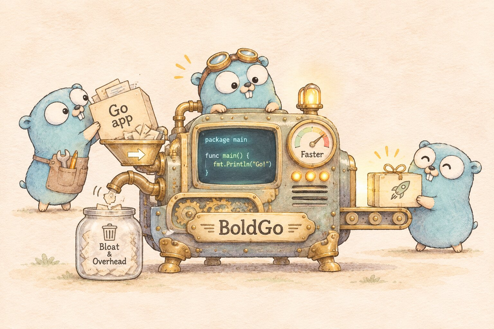

# BoldGo

*The Go gopher was designed by [Renee French][rf], licensed under [Creative Commons 4.0 Attribution license][cc4-by].*

BoldGo is a fork of Go for smaller, faster binaries. It tries ideas out
before mainstream Go gets there, so use it at your own risk.

**Versions.** BoldGo 1.27.y is based on Go 1.27 and compatible with it: the
same language and the same standard library APIs as every Go 1.27.x. Only the
last number is BoldGo's own; it counts BoldGo releases and does not track Go's
patch releases.

Go is an open source programming language that makes it easy to build simple,
reliable, and efficient software. Its canonical Git repository is located at
https://go.googlesource.com/go, with a mirror at https://github.com/golang/go.

Unless otherwise noted, the Go source files are distributed under the
BSD-style license found in the LICENSE file.

### Download and Install

#### Binary Distributions

Official binary distributions are available at https://go.dev/dl/.

After downloading a binary release, visit https://go.dev/doc/install
for installation instructions.

#### Install From Source

If a binary distribution is not available for your combination of
operating system and architecture, visit
https://go.dev/doc/install/source
for source installation instructions.

### Contributing

Go is the work of thousands of contributors. We appreciate your help!

To contribute, please read the contribution guidelines at https://go.dev/doc/contribute.

Note that the Go project uses the issue tracker for bug reports and
proposals only. See https://go.dev/wiki/Questions for a list of
places to ask questions about the Go language.

[rf]: https://reneefrench.blogspot.com/
[cc4-by]: https://creativecommons.org/licenses/by/4.0/
